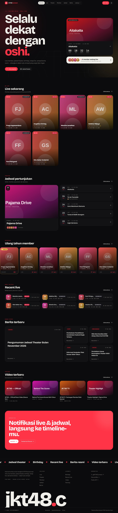
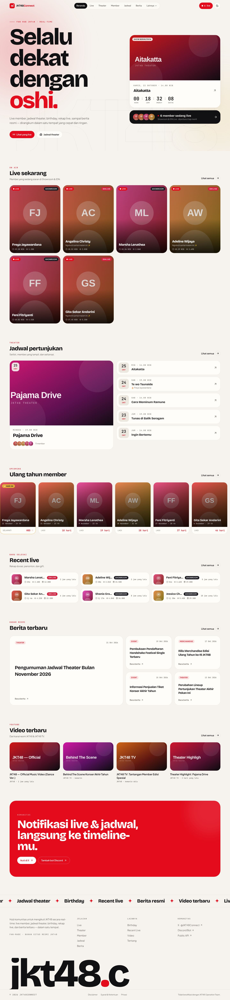
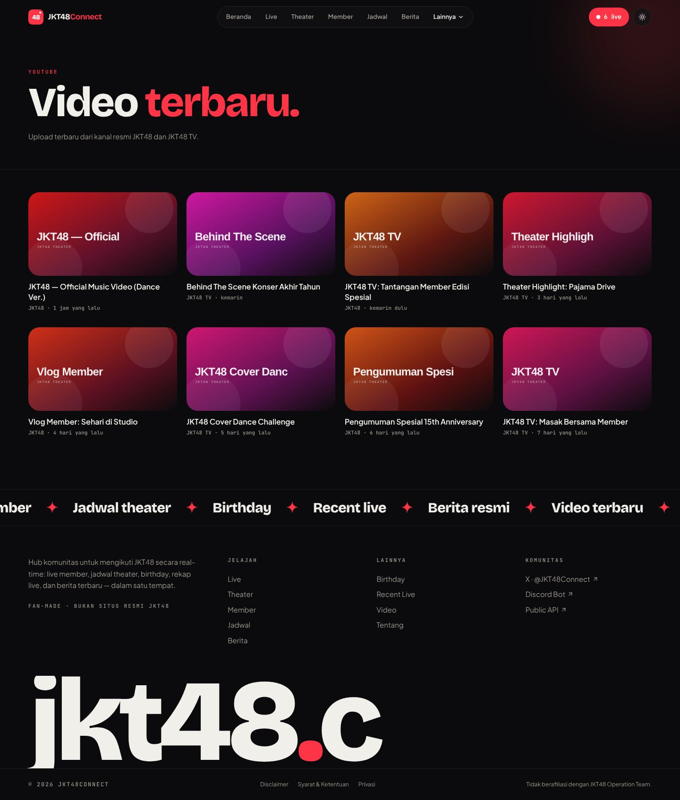

# JKT48Connect — Revamp UI

Remake UI publik JKT48Connect: landing page, header & navigasi, dan halaman publik (live, theater, jadwal, member,
birthday, recent live, berita, video, tentang, legal). Data diambil dari
[JKT48Connect API](https://api.jkt48connect.app/docs), animasi memakai **GSAP**, dan situs siap jalan di
**Cloudflare Workers** atau **Cloudflare Pages**.



## Stack

| | |
| --- | --- |
| UI | React 19, TypeScript, Tailwind CSS v4 |
| Routing & data | TanStack Router (code-split per halaman), TanStack Query |
| Animasi | GSAP + ScrollTrigger (intro, hero, reveal saat scroll, menu mobile, transisi halaman) |
| Font | Bricolage Grotesque, Plus Jakarta Sans, JetBrains Mono — self-hosted via Fontsource |
| Hosting | Cloudflare Workers (Static Assets) + Worker proxy API, atau Cloudflare Pages + Pages Functions |

## Halaman

| Route | Isi | Endpoint API |
| --- | --- | --- |
| `/` | Hero, show berikutnya + countdown, live, theater, birthday, recent, berita, video | beberapa |
| `/live` | Member yang sedang live (filter Showroom / IDN) | `GET /api/now_live?group=jkt48` |
| `/theater`, `/theater/:id` | Daftar show (paginasi) & detail: lineup, seitansai, rekaman | `GET /api/theater`, `/api/theater/:id` |
| `/schedule` | Theater + event per hari (WIB) | `/api/theater`, `/api/jkt48event` |
| `/member`, `/member/:id` | Direktori (cari, status, generasi) & profil | `GET /api/member`, `/api/member/:id` |
| `/birthday` | Ulang tahun terdekat + countdown | `GET /api/birthday` |
| `/recent`, `/recent/:id` | Rekap live: durasi, penonton, gift, leaderboard, replay | `GET /api/recent`, `/api/recent/:id` |
| `/news`, `/news/:id` | Berita resmi (HTML disanitasi DOMPurify) | `GET /api/news`, `/api/news/:id` |
| `/video` | Upload terbaru JKT48 & JKT48 TV | `GET /api/jkt48_youtube` |
| `/about`, `/disclaimer`, `/terms`, `/privacy` | Statis | — |

Intro GSAP tampil sekali per sesi browser (bisa di-skip) dan otomatis dilewati bila pengguna memilih
_reduced motion_.

## API key tetap di server

Sesuai docs JKT48Connect, API key **tidak boleh** ada di JavaScript browser. Browser hanya memanggil `/api/*` di
domain situs sendiri. Proxy di [`worker/proxy.ts`](worker/proxy.ts) lalu:

- menambahkan header `X-API-Key` dari secret `JKT48CONNECT_API_KEY`,
- hanya meneruskan endpoint publik yang dipakai UI (allowlist),
- meng-cache respons di edge (live 20 detik, recent 60 detik, lainnya 5 menit) agar kuota hemat,
- menyajikan salinan terakhir bila upstream error (5xx/jaringan).

Saat development, `vite.config.ts` melakukan hal yang sama dengan membaca key dari `.dev.vars`.

## Menjalankan lokal

```sh
npm install
cp .dev.vars.example .dev.vars   # isi JKT48CONNECT_API_KEY=jkc_…
npm run dev                      # http://localhost:5173
```

Tanpa API key / tanpa internet, pakai data contoh:

```sh
npm run dev:mock
```

## Deploy ke Cloudflare

### Setup otomatis (sekali saja)

```sh
npm run cf:setup            # login wrangler, minta API key, tulis .dev.vars, simpan secret ke Workers
npm run deploy              # build + wrangler deploy
```

### Cloudflare Workers (disarankan)

Konfigurasi ada di [`wrangler.jsonc`](wrangler.jsonc): static assets dari `dist/` dengan fallback SPA, dan `/api/*`
selalu masuk Worker dulu.

```sh
npx wrangler login
npm run deploy
npm run cf:secret           # = wrangler secret put JKT48CONNECT_API_KEY
```

Uji Worker hasil build secara lokal: `npm run cf:dev`.

### Cloudflare Pages

Folder [`functions/api/[[path]].ts`](functions/api/%5B%5Bpath%5D%5D.ts) memakai proxy yang sama.

```sh
npm run cf:setup -- --pages     # buat project "jkt48connect" + simpan secret
npm run deploy:pages            # build + wrangler pages deploy dist
```

Bila menghubungkan repo lewat dashboard Pages: build command `npm run build`, output `dist`, lalu tambahkan
secret `JKT48CONNECT_API_KEY` di **Settings → Variables and Secrets**.

### Auto deploy dari GitHub

[`.github/workflows/deploy.yml`](.github/workflows/deploy.yml) men-deploy Worker setiap push ke `main`. Tambahkan
repository secrets berikut:

| Secret | Isi |
| --- | --- |
| `CLOUDFLARE_API_TOKEN` | Token dengan template "Edit Cloudflare Workers" |
| `CLOUDFLARE_ACCOUNT_ID` | Account ID Cloudflare |
| `JKT48CONNECT_API_KEY` | Key `jkc_…` dari [dashboard](https://api.jkt48connect.app/dashboard/keys) |

[`.github/workflows/ci.yml`](.github/workflows/ci.yml) menjalankan typecheck + build di setiap PR.

## Script

| Script | Fungsi |
| --- | --- |
| `npm run dev` / `dev:mock` | Dev server (API asli / data contoh) |
| `npm run build` | Build produksi ke `dist/` |
| `npm run typecheck` | Typecheck app & Worker |
| `npm run cf:setup` | Setup Cloudflare interaktif |
| `npm run cf:dev` | Build + `wrangler dev` |
| `npm run deploy` / `deploy:pages` | Deploy ke Workers / Pages |

## Struktur

```
src/
  components/   header, footer, intro (GSAP), kartu, UI bersama
  pages/        satu file per halaman (lazy-loaded)
  lib/          api.ts (klien), jkt48.ts (normalisasi respons), queries, format, gsap
  hooks/        use-reveal (ScrollTrigger), use-theme
  mocks/        data contoh untuk dev:mock
worker/         Cloudflare Worker + proxy API
functions/      Cloudflare Pages Functions
scripts/        cf-setup.mjs
docs/screenshots/
```

## Screenshot

Diambil dari `npm run dev:mock`, jadi foto dan data yang tampil hanyalah contoh.

| | |
| --- | --- |
|  |  |
|  |  |
|  |  |
|  |  |
|  |  |
|  |  |
|  |  |
|  |  |

---

Fan-made · tidak berafiliasi dengan JKT48 Operation Team.
